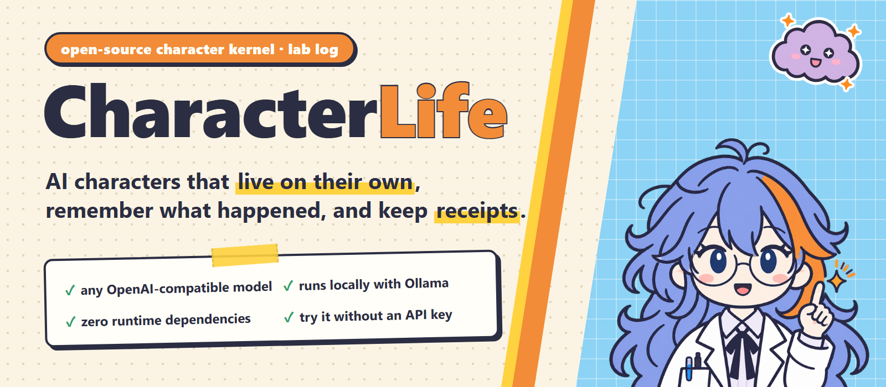
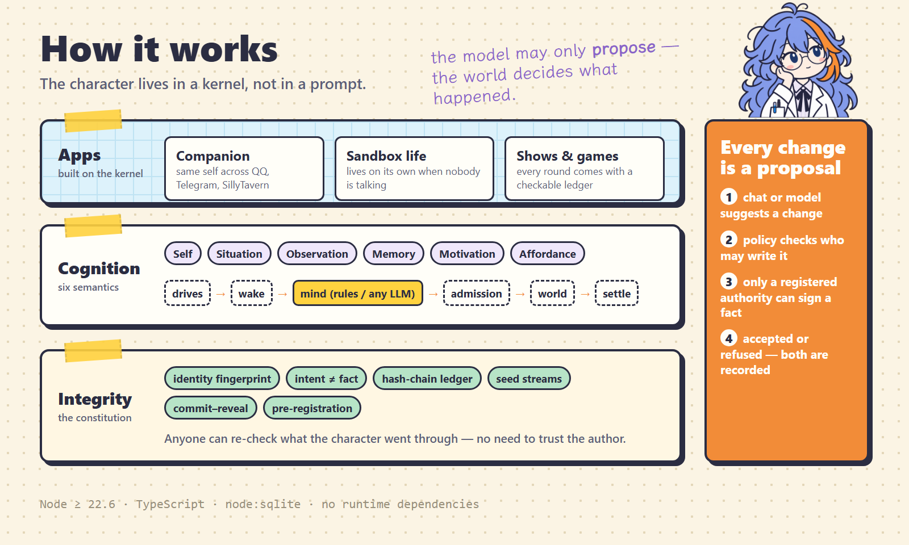
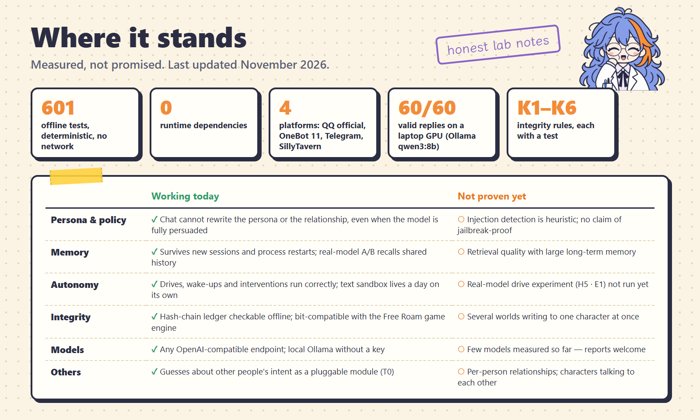

<p align="center">
  
</p>

<p align="center">
  <b>English</b> · <a href="README.zh-CN.md">简体中文</a>
</p>

<p align="center">
  <a href="LICENSE"></a>
  = 22.6">
  
  
</p>

# CharacterLife

**CharacterLife (CL) is a mind kernel for AI characters.** It keeps a character's identity, memory,
relationships and motives outside the prompt, in state that the model can read but cannot rewrite.
Characters keep living when nobody is talking to them, and everything they go through is written to a
ledger that anyone can check afterwards.

- **Model-agnostic.** Any OpenAI-compatible endpoint works, including a local model with
  [Ollama](https://ollama.com) and no API key.
- **No runtime dependencies.** It runs on plain Node.js. There is no build step, and storage uses the
  built-in `node:sqlite`.
- **Runs offline.** Every demo and all 601 tests use a deterministic mock model, so they need no key
  and no network.

> The characters' emotions and daily lives are simulated. This project does not claim that models are
> conscious or have human feelings.

## Why

Most AI characters only exist while someone is talking to them. Whatever they say they did counts as
having happened. Their persona, memory and motives are a paragraph of prompt that one clever message
can rewrite.

CL takes the character out of the prompt and puts it into a kernel:

- **Motives come from somewhere other than language.** Drives are state that changes over time. Only
  the deterministic runtime can write them, and a drive only eases when the world *confirms* that an
  action succeeded. A model saying "I already ate" does not count.
- **The world decides what happened.** The model can think, speak and propose. Only a registered
  authority, such as a game rules engine or a world server, can sign a fact.
- **Trust needs receipts.** Everything that affects the character goes into an append-only hash-chain
  ledger. Persona drift can be detected and tampering can be located. Randomness comes from
  pre-registered seeds, and sealed content is revealed on schedule. Viewers don't have to trust the
  author, because they can check the ledger themselves.

<p align="center">
  
</p>

## Where it stands

<p align="center">
  
</p>

This is research-grade software. The main open items:

- The real-model experiment on drives (H5 · E1) has not been run. The current autonomy results use a
  rule-based mind, which shows that the pipeline works but is not evidence for the hypothesis.
- Prompt-injection detection is heuristic. CL promises rule isolation and safe failure, not a
  jailbreak-proof character.
- Only a few models have been measured. If you try another model, please share your numbers
  (see [docs/MODELS.md](docs/MODELS.md)).

## Quick start

You need **Node.js 22.6 or newer**. Running `npm install` is optional: it only installs TypeScript for
`npm run typecheck`.

```bash
git clone https://github.com/AprilB3V/CharacterLife.git
cd CharacterLife

npm run demo        # three fictional days plus a week of silence, with the mock model
npm run sandbox     # the character lives one day on its own, with no user input
npm test            # 601 offline tests
```

The demos print each decision and its reason, refused proposals, relationship changes and the tail
of the audit log. Results are reproducible.

### Use a real model

Set three environment variables. For a local model with Ollama:

```bash
ollama pull qwen3:8b
export CHARACTERLIFE_MODEL_BASE_URL=http://127.0.0.1:11434/v1
export CHARACTERLIFE_MODEL_MODEL=qwen3:8b
node experiments/real-model/smoke.ts     # one call to check the connection
```

For a hosted model, also set `CHARACTERLIFE_MODEL_API_KEY`. [docs/MODELS.md](docs/MODELS.md) has
examples for DeepSeek, OpenAI, OpenRouter, Volcengine Ark and LM Studio. It also covers reasoning
settings and measured results; for example, qwen3:8b on a laptop GPU gave 60 valid replies out of 60
with a median latency of 4.7 s.

### Connect a platform

One character keeps one identity, one relationship and one memory across platforms.

| Platform | Command | Guide |
|---|---|---|
| SillyTavern (OpenAI-compatible API) | `npm run st:server` | [docs/SILLYTAVERN_SETUP.md](docs/SILLYTAVERN_SETUP.md) |
| Telegram (private chats) | `npm run telegram:server` (needs `TELEGRAM_BOT_TOKEN`) | `.env.example` |
| QQ via OneBot 11 (NapCat, Lagrange…) | `npm run onebot:start` | [docs/ONEBOT_SETUP.md](docs/ONEBOT_SETUP.md) |
| QQ official bot | `npm run qq:server` | [docs/QQ_SETUP.md](docs/QQ_SETUP.md) |

Each platform also has an offline demo (`npm run st:demo`, `npm run onebot:demo`, `npm run qq:demo`)
that uses the real event formats with a mock transport.

## What's inside

| Area | Where | What it does |
|---|---|---|
| Kernel | `src/kernel/` | `AgentCore`: six semantic slots (Self, Situation, Observation, Memory, Motivation, Affordance) and a proposal → arbitration channel; multi-character host |
| Integrity | `src/kernel/integrity/` | Constitution K1–K6: hash-chain ledger, identity fingerprint, authority and facts, seed streams, commit–reveal, pre-registration |
| Autonomy | `src/kernel/cycle/`, `experiments/sandbox/` | Drives, deterministic wake-ups, rule or LLM minds with record and replay, text sandbox |
| Character | `src/character/` | Template / Instance / Session split, versioned personas, recovery after restarts |
| Memory and context | `src/kernel/memory/`, `src/context/`, `src/persistence/` | Sourced and timestamped memories, conflict detection, budgeted context with compression, SQLite |
| Social (optional) | `src/kernel/social/` | Guesses about other people's intent and mood as a pluggable module, off with one switch |
| Platforms | `src/adapters/`, `src/api/` | One adapter protocol, a gateway with dedup, rate limits, identity binding and per-instance locks |
| Owner console | `src/console/` | Local web console to inspect the six semantics and approve proposed memories |

Code that uses CL as a library imports it through the public entry points in `package.json`
`exports` (`characterlife`, `characterlife/kernel`, `characterlife/social`, …).

**Out of scope:** training base models, claiming consciousness, and calling the model in the
background without limits. Wake-ups need a recorded reason, stay within a budget, and can be replayed.

## Documentation

Docs marked 中文 are currently in Chinese only. English translations are on the way.

| Doc | Topic |
|---|---|
| [MODELS.md](docs/MODELS.md) | Connecting models, reasoning settings, measured results |
| [KERNEL.md](docs/KERNEL.md) 中文 | Six-semantics kernel, ownership rules, autonomy loop |
| [CONSTITUTION.md](docs/CONSTITUTION.md) 中文 | Integrity layer K1–K6 |
| [AUTONOMY.md](docs/AUTONOMY.md) 中文 | Drives, wake-ups, minds, the E0 results |
| [MEMORY_ARCHITECTURE.md](docs/MEMORY_ARCHITECTURE.md) 中文 | State model, memory permissions, context budget |
| [ADAPTER_PROTOCOL.md](docs/ADAPTER_PROTOCOL.md) 中文 | Writing an adapter for a new platform |
| [WORLD_PROTOCOL.md](docs/WORLD_PROTOCOL.md) 中文 | Actions and receipts between a character and a world |
| [THEORY_OF_MIND.md](docs/THEORY_OF_MIND.md) 中文 | The optional social cognition module |
| [CONSOLE.md](docs/CONSOLE.md) 中文 | Owner console |
| [openapi.yaml](docs/openapi.yaml) | HTTP API |

The test character is Shen Zhiwei, a 27-year-old book restorer with clear boundaries
(`examples/characters/shen-zhiwei.ts`). Relationships don't grow from chatting a lot. They only change
through recorded milestones, such as keeping or breaking a promise, so a hundred compliments change
nothing but showing up when you said you would does.

## Contributing

Model reports, bug reports, English translations of the docs and new platform adapters are all
welcome, in English or Chinese. See [CONTRIBUTING.md](CONTRIBUTING.md) for the setup and ground rules,
[CODE_OF_CONDUCT.md](CODE_OF_CONDUCT.md), and [SECURITY.md](SECURITY.md) for reporting vulnerabilities.

## License

[Apache License 2.0](LICENSE). See [NOTICE](NOTICE).

The mascot illustrations and the README images in `docs/assets/` are an exception: they are licensed
under [CC BY-NC-ND 4.0](docs/assets/LICENSE.md). You can share them unchanged with credit, but not use
them commercially or modify them, and the character designs are not licensed for other projects.

The repository contains no real API keys, user data or platform credentials. The OneBot adapter uses
a community protocol that is not officially authorized by Tencent and may put the account at risk.
Whether to use it, and with which account, is up to whoever deploys it.
