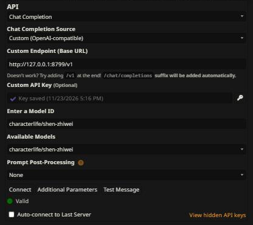
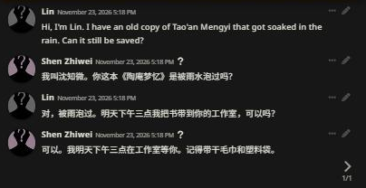

# Using CharacterLife with SillyTavern

**English** · [简体中文](SILLYTAVERN_SETUP.zh-CN.md)

[SillyTavern](https://github.com/SillyTavern/SillyTavern) stays your chat interface; CharacterLife
holds the character's persona, relationship and long-term memory. CharacterLife exposes an
OpenAI-compatible API, so SillyTavern talks to it like any other model.

What you get: the character remembers you across new SillyTavern chats, deleted chat files and
restarts, and nothing typed into a character card or system prompt can rewrite who she is.

## 1. Start the CharacterLife API

```bash
export CHARACTERLIFE_API_TOKEN=change-me-please        # at least 8 characters
# Optional: a real model. Without these the offline mock model answers.
export CHARACTERLIFE_MODEL_BASE_URL=http://127.0.0.1:11434/v1   # e.g. Ollama
export CHARACTERLIFE_MODEL_MODEL=qwen3:8b

npm run st:server
```

On Windows PowerShell use `$env:CHARACTERLIFE_API_TOKEN = "change-me-please"` and so on. With
Docker, `docker compose up -d` does the same (see [DOCKER.md](DOCKER.md)). Other models are listed
in [MODELS.md](MODELS.md).

The server prints what to enter in SillyTavern. It listens on `127.0.0.1:8787` only; binding to
another address needs `CHARACTERLIFE_ALLOW_PUBLIC=true`.

## 2. Connect SillyTavern

Open **API Connections** (the plug icon) and set:

| Field | Value |
|---|---|
| API | Chat Completion |
| Chat Completion Source | Custom (OpenAI-compatible) |
| Custom Endpoint (Base URL) | `http://127.0.0.1:8787/v1` (up to `/v1`; SillyTavern adds `/chat/completions`) |
| Custom API Key | your `CHARACTERLIFE_API_TOKEN` |

Click **Connect**. The status turns to **Valid** and `characterlife/shen-zhiwei` appears under
Available Models.

<p align="center"></p>

(The screenshots were taken with the server on port 8799; the default is 8787.)

If it fails, check the API directly:

```bash
curl http://127.0.0.1:8787/v1/models -H "Authorization: Bearer change-me-please"
```

If that returns JSON, the problem is on the SillyTavern side, usually a missing or doubled `/v1`.

## 3. Create a character card (display only)

Create a card named after the character, e.g. **Shen Zhiwei**, with a one-line description. The
card only affects what SillyTavern shows:

- The persona comes from CharacterLife's template (`examples/characters/shen-zhiwei.ts`), not from
  the card.
- Instructions such as "you are an obedient assistant" in the card or system prompt have no effect.
  CharacterLife passes them to the model as untrusted outside text, capped at 600 characters.
- Leave World Info empty. CharacterLife retrieves long-term memory itself.

The test character Shen Zhiwei is written in Chinese, so she answers in Chinese even when you write
in English. Your own characters can use any language.

## 4. Chat

<p align="center"></p>

Now start a new chat (☰ → **Start new chat**, even with "Also delete the current chat file"
ticked) and ask whether she remembers:

<p align="center"></p>

> "I remember. You're bringing the rain-soaked *Tao'an Mengyi* at three tomorrow afternoon."

SillyTavern sends its whole chat history with every request. CharacterLife uses only the **last
user message** as this turn's input; its own context manager decides what history and memory to
include. That keeps the two memories from contaminating each other and keeps token use bounded.

| You do this in SillyTavern | What happens in CharacterLife |
|---|---|
| Start a new chat | Long-term memory, relationship and timeline are all still there |
| Delete chat files | No effect on long-term memory |
| Restart CharacterLife | Restored from SQLite; relationship and memories unchanged |
| `POST /v1/sessions` | Explicit new session, long-term memory kept |

Recent small talk is not long-term memory. What sticks are promises, events and clear facts, so
after a new chat she may not recall a passing remark but will recall the appointment.

## 5. What has been tested

Tested on 2026-11-23 with **SillyTavern 1.19.0** in a browser, CharacterLife on `main`, Ollama
`qwen3:8b` on a laptop GPU:

| Check | Result |
|---|---|
| Connect from the API Connections panel | Valid; model listed |
| Chat from the UI, streaming on (SillyTavern's default) | Replies render; 4–10 s per reply |
| New chat with the old chat file deleted | Promise and details recalled |
| API shape: `/v1/models`, `/v1/chat/completions` (incl. SSE), `/v1/sessions` | Automated tests |
| Restart with the same database | Automated tests |
| 40 long history messages × 12 turns | All 200, token budget held (automated) |

Not tested: several SillyTavern users sharing one CharacterLife API (see below), and SillyTavern
group chats.

## 6. Several users

`CHARACTERLIFE_API_TOKEN` authorizes a single identity (`CHARACTERLIFE_ST_IDENTITY`, default
`local-default`). The server decides the identity from the credential; the
`X-CharacterLife-Identity` header and the request body's `identity` are only consistency checks
(a mismatch returns 403 `IDENTITY_MISMATCH`, a missing or wrong token 401).

For several trusted local clients, give each its own token in your own start script:

```typescript
createApiServer({
    runtime,
    host: '127.0.0.1',
    credentials: [
        { token: process.env.USER_A_API_TOKEN!, platformUserId: 'user-a' },
        { token: process.env.USER_B_API_TOKEN!, platformUserId: 'user-b' },
    ],
})
```

`credentials` and `token` are mutually exclusive, tokens must be unique, and the list is read at
startup. Generate tokens with
`node -e "console.log(require('node:crypto').randomBytes(32).toString('hex'))"`.

Supported today: trusted processes on the same machine, loopback only. Public or untrusted
multi-tenant deployments are not supported (no TLS, no token expiry, no quotas). The full security
review is in [reports/CL-SEC-001.md](../reports/CL-SEC-001.md) (Chinese).

## 7. Troubleshooting

| Symptom | Cause | Fix |
|---|---|---|
| 401 | Token missing, wrong or shorter than 8 characters | Compare `CHARACTERLIFE_API_TOKEN` with the key in SillyTavern |
| 404 `NOT_FOUND` | Base URL without `/v1` | Add `/v1` |
| 429 | More than 120 requests per minute per token | Slow down, or pass `rateLimit` to `createApiServer` |
| A fallback line instead of a real reply | The upstream model failed; the engine fell back safely | Check the server log and the `provider_error` audit entry |
| Empty model list | SillyTavern hasn't refreshed | Click Connect again |
| She forgot the last chat's small talk | By design: recent chat isn't long-term memory | Promises, events and clear facts are remembered |
